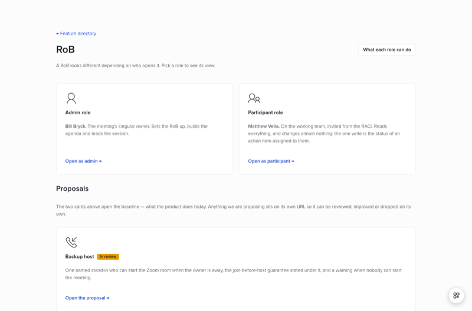
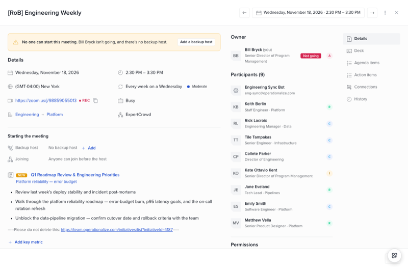
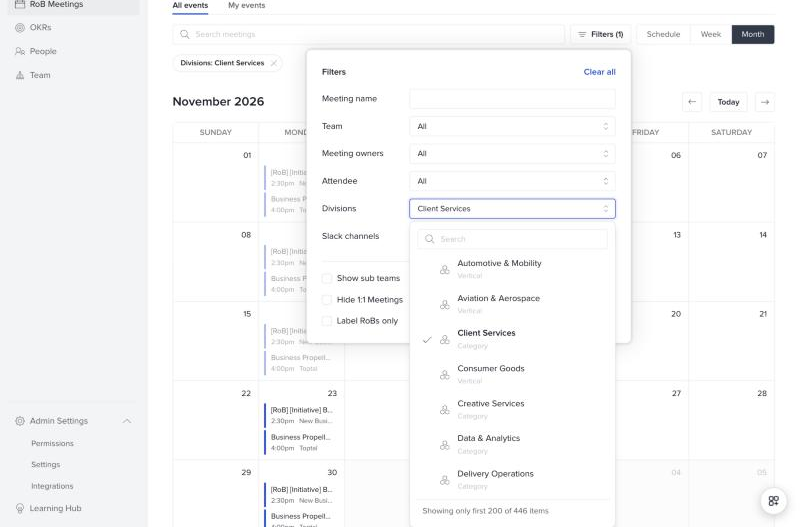
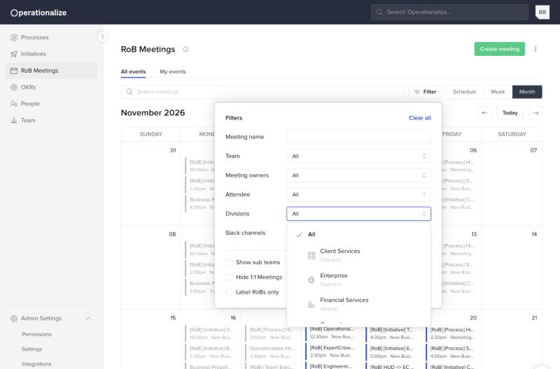
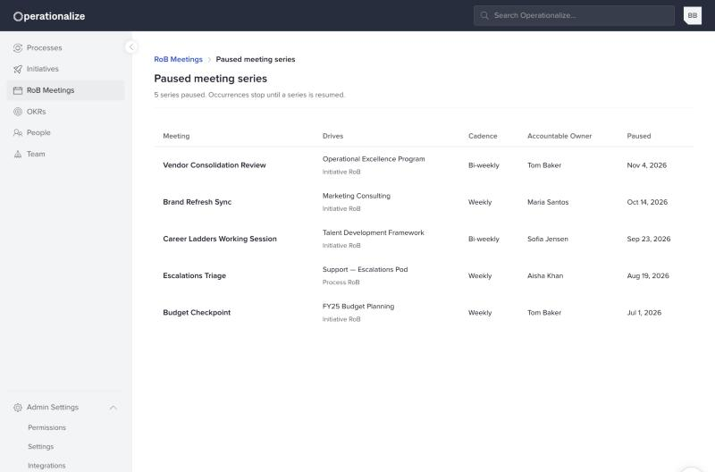
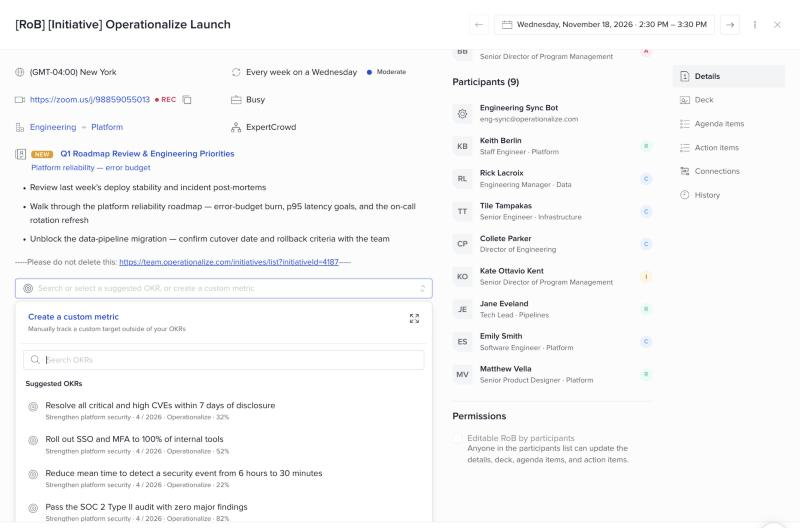
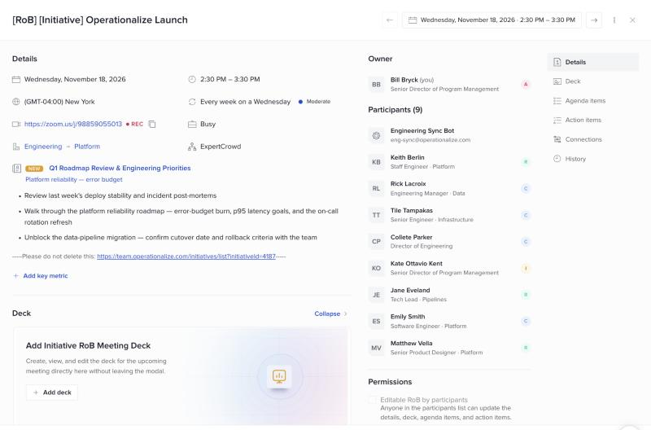

# RoB Meetings — prototype changelog

Where this prototype and the product disagree, and why. That is the section
directly below; the rest of the file is how it got there.

- **[Reach the variants](#reach-the-variants)** — the flows that only exist
  behind a URL. Several good ideas live there and nowhere else.
- **[Open, and worth revisiting](#open-and-worth-revisiting)** — decisions that
  were parked rather than settled, each with the commit that still holds the
  work.
- **[History](#history)** — what was built, in what order.
- **[BACKLOG.md](./BACKLOG.md)** — what has not been built: gaps, ideas and the
  questions worth a screen. Nothing is in both files.

---

## Where it departs from the product

**The reason this file exists.** A prototype that matched the product in every
respect would need no changelog — you could read the product. These are the
places it does not, each with the rule that says what the product does.

**We propose a change.** Built deliberately against the rule, because we think
the rule is wrong. Each one is a proposal, and needs saying out loud when it
goes to review.

Since 2026-11-20 a proposal lives in its own version folder rather than in the
baseline, so **Where** is the way in — each one opens the prototype that row
describes, and every row here names a version rather than the baseline.

**A difference is not automatically a proposal**, which is why this table is
shorter than the list of ways the prototype and the product differ. The
recurrence options model the Operating Framework's policy rather than Google's
generic rule; the filters are single-select because this prototype never built
multi-select, which is a limitation and not an argument. Those are described
where they are built, not here. A row earns its place by being a change we
would defend.

**The baseline is still not 1:1 with the product.** The two rows in the next
table follow the spec where the shipped product has an open deviation, and
underneath that it is a prototype: fixtures, invented people, no backend, and
only the directory and the meeting view rather than the module.

The **Rule** column cites the Operationalize behaviour spec, an internal
reference that says what the product does. The ids are checkable by the team
and not from here, which is why they are not links.

| Here | Where | The product | Rule |
|---|---|---|---|
| A series can name one **backup host**, who can start the Zoom room when the owner is away | [`v2-backup-host`](./v2-backup-host/) | has no backup-host concept at all — the room is created with the owner as host and an existing room is never reused or chosen | `ROB-ZOOM-001`, `ROB-OWNER-020` |
| The meeting view states that **anyone can join before the host**, and the proposal is that the product hold the waiting room off | [`v2-backup-host`](./v2-backup-host/) | forces join-before-host ON but never touches `settings.waiting_room`, and in Zoom the waiting room overrides join-before-host | `ROB-ZOOM-009` |
| An occurrence whose owner is not going, with no backup host, says **nobody can start it** | [`v2-backup-host`](./v2-backup-host/) | marks the declined person on the upcoming occurrence and stops there — it draws no consequence from the one decline that costs the meeting its host, and the owner has no way to decline in the product at all | `ROB-OCC-067`, `ROB-OCC-096` |
| The **create form** names an alternative host, chosen from the participants being invited | [`v2-backup-host`](./v2-backup-host/) | has no such field on create — the Zoom room is made with the owner as its only host (`ROB-ZOOM-001`), and `settings.alternative_hosts` is never written | `ROB-ZOOM-001`, `ROB-ZOOM-009` |
| A week-view slot click draws a draft block and asks **Create meeting / Cancel** | [`v3-week-slot`](./v3-week-slot/) | opens the Create meeting form straight away | `ROB-VIEW-053` |
| Clicking a past slot in the week view says why nothing happened | [`v3-week-slot`](./v3-week-slot/) | nothing happens — the slot has no pointer and no handler, and the click is swallowed | `ROB-VIEW-053` |

**We follow the spec where the product does not.** Not proposals: the rule is
already the rule, and the shipped code has an open deviation from it. Built to
the rule, with the deviation's id beside it — so a reviewer who tries this in
the real app and sees something else knows which of the two is the bug.

| Here | The product today | Rule | Deviation |
|---|---|---|---|
| A cancelled occurrence's agenda is read-only, and says why | its agenda items, action items and pre-read links stay editable | `ROB-AGENDA-065` | `B-187` |
| **Mark as discussed** appears only once the occurrence has started | it is offered and accepted on any occurrence, future ones included | `ROB-AGENDA-066` | `B-191` |

A row leaves this section when the product adopts the proposal, overrules it, or
fixes the deviation — not when we stop thinking about it.

---

## Reach the variants

**Two different things are called a variant here, and they are kept apart.**

A **view** of the same product decision — a role, a respond flow, one
occurrence — is a URL on the same file, never a copy. That rule was learned the
hard way: this started in Aug 2026 as `action-items`, beside a near-duplicate
called `rob-flow` that every change had to be mirrored into. Both sit in
`../archive/`, and the old `/action-items/` URL 404s. At ~1.3 MB a duplicate
drifts within days, so a switch stays a switch.

A **proposal** is a copy, on purpose, since 2026-11-20. It is a different
product decision, and it has to be reviewable on its own, improvable without
touching the baseline, and droppable by deleting a folder. Keeping proposals
inside the baseline made `rob/` a thing we described as production-faithful
while it rendered six changes the product has never seen. So the baseline is
`v1-baseline`, each proposal branches off it, and `versions.json` lists them.
The duplication is real and is the price: a baseline fix now has to be re-baked
into every version folder.

| URL | What it opens |
|---|---|
| `rob/` | redirects to the baseline, carrying the query and hash. Old links keep working |
| `rob/v1-baseline/` | **the baseline** proposals branch off — close to the product, not identical (see the note under the departures table). The admin owner's view: Bill Bryck, who owns this series *and* holds "Manage all RoB meetings" |
| `rob/v2-backup-host/` | **a proposal, in review** — alternative hosts, the join guarantee and the nobody-can-start warning, on the meeting view **and** the create form |
| `rob/v3-week-slot/` | **a proposal, in review** — the week-view slot click draws a draft and asks before the form opens, and a past slot says why nothing happened |
| `rob/roles.html` | the role chooser, this prototype's sign-in screen, and where the proposals are listed. Sign out returns here |
| `rob/rights.html` | the oracle rights table — **What each role can do**, from the button beside the chooser's title. This file is rendered on the chooser itself, below the role cards |

**The baseline has one row because it is one build.** What used to be five rows
here — a role, a respond flow, one occurrence — are switches on that same
screen, not separate things to maintain. They are listed once, below, and they
work on any version:

| Switch | What it does |
|---|---|
| `?role=participant` | the participant's view — Matthew Vella, attending, assignee of one action item |
| `?role=rob-admin` | an admin who does **not** own the series, so the deck rights are absent (`ROB-ACCESS-002`) |
| `?roles=1` | the bottom-left role switcher, for walking all three side by side |
| `#respond=modal` | the original respond flow — the row's icon opens the reject modal directly. `=direct` is a synonym, and `?respond=` works too |
| `#occurrence=YYYY-MM-DD` | deep-links one occurrence of the meeting named in the view |
| `?versions=1` | the version switcher |
| `?changes=1` | what this version changed against the one it branched from |

Every path also works without `v1-baseline/`, through the redirect.

Default respond flow is the **status menu** (Going / Reject / Maybe), not the
modal. Prefer the hash form: the desktop preview pane drops `?params` on the way
to the page, and a hash survives both it and Vercel.

---

## Open, and worth revisiting

- **Agenda items in the Create form.** Built, wired against `ROB-AGENDA-001…038`,
  then removed: the product has no agenda section at create time, and whether it
  should is an open spike upstream. The call was "a shell first, populated
  from the meeting view". If the spike lands the other way, the working version
  is in commit **b14f2c6** — take it from there rather than rebuilding.
- **Eight static `.btn-primary`, one per modal.** The only reason this file still
  carries its `designmd:legacy` marker. The `[two-primary]` rule exempts
  script-built surfaces — one is never on screen beside the page's own CTA — but
  not static hidden overlays. Flattening a modal's confirm to secondary would be
  the wrong fix, so it needs a decision, not a workaround.
- **The rejection tooltip wants a badge.** The reference shows a "Declined" pill
  above the sentence; designmd's tooltip is one plain-text string driven by
  `attr()`, so it cannot carry one. The copy was written to stand without it
  ("declined this meeting"). Switching to a DOM tooltip was left as a later ask.
- **The Slack channel names are invented.** A screenshot of the real app showed
  `-c-proj-…` and `-ba-bau-…` prefixed channels that look nothing like these.
  The fixtures obey `ROB-VIEW-027`; they do not look like the tenant. Paste the
  real list over `SLACK_CHANNELS` when someone has it.
- **Click-to-create asks first.** See [the departures](#where-it-departs-from-the-product).

---

---

## History

### 2026-11-23 — Alternative hosts, and the create form *(local on `rob-version-split`)*

**Status** · In review — `v2-backup-host`

The field v2 put in the meeting view works, now, and is named the way Zoom
names the setting it writes.

Three things were wrong with it before that. It opened from an `Add` button
that sat against the panel edge with a few pixels to hit, the menu it opened
was a fixed 280px hanging inside a 256px column, and both were consequences of
the same decision: label, value and control sharing one line in the narrowest
column on the screen. It is a labelled field on its own line now, always on
screen, with the chosen person inside it — and the menu is pinned to the
field's own edges rather than given a width. Clearing it moved into the list as
`No alternative hosts`, so one control both sets and unsets the value.

The naming went with it. **Alternative hosts**, Zoom's words, not the
`backup host` the first pass argued for — and the two alerts still say
`backup host`, which is the last of the old vocabulary on screen. The section
kept the baseline's own **Permissions** heading rather than the
`Who can do what` it briefly had, which collided with `rights.html`'s
*What each role can do*; and it reads shipped-first now — `Editable RoB`,
then the join guarantee, then the field.

**The same two rows are in the create form.** That is where the problem
actually lands: the ops instruction owners are given today — add an
alternative host, turn the waiting room off — is handed to them while they are
making the meeting, not a screen later. Candidates are the participants being
invited and nobody else (`ROB-ZOOM-001` creates one room for the series, and
Toptal's own rule is that the host must be on the invite), so the field fills
as people are added and clears itself if the chosen one is taken back off. It
has no search box: nine roster rows wanted one, three fresh picks do not. What
is chosen is carried into the meeting on Create, the way
`editableByParticipants` already was — a field whose value is dropped at Create
would be decoration.

This started as its own folder, `v4-create-hosts`, and was folded back the
same day. It was never a separate decision: a proposal that puts a field on one
screen and not the other is half a proposal, and reviewing the halves apart
invites agreeing to one of them. One version, both screens.

Two notes against it. The create form was locked on 2026-11-09 as a shell,
which is why this lives in a version folder at all — the lock holds in
`v1-baseline`. And the create → view hand-off only restores state for meetings
made in the session; opening a seeded meeting afterwards leaves the field as
the last one left it, which is pre-existing in the same handler and still wants
fixing.

---

### 2026-11-20 — Proposals move out of the baseline *(local on `rob-version-split`)*

**Status** · Structural — no product decision changed, but where each one lives did, and the departures table now says which URL.

`rob/` was described as production-faithful while rendering six changes the
product has never seen. A proposal and the thing it is a proposal *about* were
the same URL, so there was no way to hand someone the baseline, or to drop an
idea without surgery on a 1.3 MB file.

So the family splits. `v1-baseline` is the closest thing to the product this
repo holds; a proposal branches off it into its own folder, listed in
`versions.json`, and
`rob/` is a redirect that carries the query and hash so every existing link
still lands. [Where it departs](#where-it-departs-from-the-product) gained a
**Where** column, and that is how a reviewer picks one up: the row that
describes a proposal is also the link that opens it. A separate card listing
the proposals was built first and taken out again — it put the same thing in
two places, and the table was the one already saying what each proposal is.

**This reverses a rule the file used to state**, and the reversal is narrower
than it looks. "A variant is a URL, not a copy" was written after `action-items`
and `rob-flow` drifted apart in Aug 2026, and it still holds for a *view* of the
same decision — a role, a respond flow, one occurrence. It does not hold for a
*proposal*, which is a different decision and has to be reviewable, improvable
and droppable on its own. The duplication is real, and the price is that a
baseline fix now has to be re-baked into every version folder.

**The backup host moved first**, to prove the pattern, and the week-view slot
behaviour followed the same day as `v3-week-slot` — both rows `ROB-VIEW-053`
owns, since the confirm step and the past-slot toast are the same gesture.

**The rest turned out not to need moving**, which is the more useful finding.
Four rows were sitting in the departures table describing things that are not
proposals: recurrence modelling the Operating Framework's policy, and filters
that are single-select because nobody built multi-select. A limitation is not
an argument, and policy is not a change we are asking the product to make.
They came out of the table rather than into a version folder.

One that is a real difference came out with them: the prototype's action items
carry threaded comments and the product's do not (`ROB-ACTION-008` — notes
shipped in June 2026 and were removed within a week). Dropping the row does not
drop the behaviour, so that is still live in the baseline and still needs
deciding: extract it, or take it out.

Stripping that one taught the shape of the work. The proposal was not a block
to delete: the baseline had to be given the behaviour the rule describes, which
is the form opening straight away on a future slot and nothing at all on a past
one. Two things nearly went out with it — `clock()`, which the slot aria-labels
use, and a `closeDraft()` call in `renderWeek` that would have thrown on every
redraw. Neither was part of the proposal; both lived in its block.

### 2026-11-20 — A backup host, and who can start the meeting *(local on `rob-week-grid`)*

**Status** · Proposed — all of it. The product has no backup host, does not manage the waiting room, and does not warn anyone.

Raised from the floor: a RoB whose owner is absent can fail to happen at all.
Participants sit in a waiting room, nobody can start the room, and someone
improvises a new call and re-invites everyone. Owners are being handed a
two-step manual fix — add an alternative host who is on the invite, and turn the
waiting room off for that meeting. Both are Zoom API fields. Neither is
reachable from Operationalize.

**Our own notes were too generous about the product here, and this corrects
them.** `ROB-ZOOM-009` holds every RoB-linked Zoom meeting at join-before-host
ON, which should mean the owner being away costs the meeting its host and not
its start. `BACKLOG.md` listed three ways that fails to reach a room — webinars,
no Zoom integration, and `B-014`. There is a fourth, and it is the one ops is
working around: the product enforces three settings and `settings.waiting_room`
is not one of them, and **in Zoom the waiting room overrides join-before-host**.
A room the product manages correctly, on the right host, with a live
integration, still strands everyone if the waiting room is on at the account,
group or user level. Join-before-host being ON is not evidence that anyone can
get in.

So the screen states the guarantee — *Anyone can join before the host* — rather
than offering it as a toggle. A RoB with a waiting room is broken, not
configured; the fix belongs in enforcement, as a fourth setting beside the three
`ROB-ZOOM-009` already holds.

**The backup host is one name, and it belongs to the series.** `ROB-ZOOM-001`
creates one Zoom meeting per series, of type *recurring with no fixed time*, so
`settings.alternative_hosts` hangs off that single room — there is nowhere in
Zoom to put a per-occurrence stand-in. "I am away next Tuesday" is served by
editing the field ahead of time. One name rather than Zoom's list, because a RoB
has a singular Accountable Owner and a list of hosts invites the question of who
is actually running the meeting. Called a *backup host* rather than Zoom's
*alternative host*: alternative reads like a second owner, backup says when it
matters.

**A field nobody fills in is not a safeguard**, so the occurrence says when it
is uncovered. The owner not going with no backup host set is an amber alert with
the picker on it; a backup host set under the same condition drops it to a blue
one naming who will start the meeting. It is a standing condition of that
occurrence rather than something that just happened, so an alert and not a toast.

**The data for this arrived eight days ago**, which was worth finding out before
drawing the screen. A change upstream on 2026-11-12 gave participants a
per-occurrence **Decline** with an optional comment, and `ROB-OCC-067` now draws
a red ✕ on an upcoming occurrence — before, a future occurrence showed no
response at all. So the product does know, in advance, that someone is not
coming.

What it does not do is read anything into it. A decline is a mark beside a name;
nothing distinguishes the one person whose absence costs the meeting its Zoom
host from the eight whose does not. And `ROB-OCC-096` is explicit that the
actions are **not offered to the owner** — so the one person this turns on
cannot decline in the product at all, only in Google Calendar, which
`ROB-OCC-067` does surface. That is the departure: not the signal, the
consequence.

Out-of-office is still the older story. `ROB-OCC-025` computes OOO only from an
hour after the occurrence ends, and the absence that an owner actually plans —
with a named stand-in already attached to it — lives in time off, which the RoB
cannot read. That is a backlog item rather than part of this.

Candidates come from the roster, which is Toptal's own rule — Zoom only asks for
a licensed user on the same account. `ROB-OWNER-020` is left open: a transfer
mints a new Zoom room, and nothing carries a backup host across it — and since
2026-11-05 that room reliably reaches the moved series, so it is the behaviour
and not a bug that would drop the field. The states
are on `#backup=set|none|covered|ineligible|nozoom`.

### 2026-11-16 — The filter menus, and the one thing single-select costs *(local on `rob-division-icon`)*

**Status** · Proposed — the clear-by-reselect is ours; the rest of this pass was the prototype catching up with the product.

Most of this was correction. The divisions options drew a different glyph per
kind, where the product draws one for all of them and lets the type underneath
tell them apart (`ROB-VIEW-026`); the picker had no search box and no sign that
it was holding anything back; and all five menus opened with an **All** row.

That last one was the interesting mistake. `ROB-VIEW-019` says every select
*shows the placeholder "All"* — on the trigger, where ours has always shown it.
A multi-select has no "All" to pick, because the way to mean "all" is to tick
nothing. Reading the placeholder as an option put a row in the list that the
product does not have.

**Taking it out is what costs something.** In the product you clear a filter by
unticking; ours is single-select, so with the row gone the first pick was a
one-way door — only **Clear all**, which empties every other filter too, got
you out. So clicking the chosen option again clears it. That is a gesture the
product has no need for, and it is in [Where it departs](#where-it-departs-from-the-product)
as one: it exists only because the single-select does.

The rest, briefly. Divisions is **446** now rather than fifteen, because a
200-row cap and a search box mean nothing against a list that fits on screen —
about a hundred names across the six kinds (`ORG-DIV-001`) and a tail crossed
from verticals and disciplines, so the invention is one decision rather than
three hundred. The menu shows seven options: its height is clamped to the room
below the field, because it is absolutely positioned inside a popover that
cannot scroll, and a fixed height put the count line a quarter of a screen
below the bottom of the window with no way to reach it.

### 2026-11-13 — Click to create, on the week view *(7ed5064, local on `rob-filters-and-click-to-create`)*

**Status** · Proposed — it asks before opening the form where the product opens it (`ROB-VIEW-053`), so it is a change to propose, not a screen to copy. The group has not seen it, and RoB is not what the team is working on, so expect it to sit for a few weeks.

An hour in the week grid is now two 30-minute slots, as real elements rather
than arithmetic on a column click — "a past slot shows no pointer"
(`ROB-VIEW-053`) is a per-slot affordance a column cannot carry. Clicking an
empty future slot draws a 30-minute draft in place, the same block and type as a
meeting but dashed while it is only a proposal, and a popover beside it asks:
**Cancel** / **Create meeting**.

**The confirm step is the proposal.** `ROB-VIEW-053` opens the form on the
click. The week is dense, the form is full-screen, and a mis-click is far
cheaper to make than to get out of — so the draft is drawn and the question
asked first. What **Create meeting** finally opens is the same form, pre-filled
the same way the month grid's click-to-create fills it: date, slot start, slot
start + 30.

Escape, a click elsewhere, or **Cancel** clears the draft; clicking a different
slot moves it rather than closing first. Anything that redraws the week — a
filter, a tab, a lifecycle change — clears it too. The popover is fixed-position
on the body, because `.cal-week-body` clips: a panel beside a Friday slot or a
7 pm one would otherwise be cut in half.

The rule's known deviation, **B-136** (the 23:30 slot pre-fills an end before
its start), cannot arise here — the grid stops at 8 pm.

### 2026-11-10 — Divisions and Slack channels start filtering *(ea3d17c, local on `rob-filters-and-click-to-create`)*

**Status** · Delivered — the behaviour follows the rules. The fixture data is invented and does not resemble the tenant's, which is still [open](#open-and-worth-revisiting).

Two of the six filter controls had been built and wired to nothing. They narrow
the calendar now, which meant inventing the data they narrow by — and that is
the part worth recording.

**The oracle holds rules, not data.** There is no seed fixture, tenant record or
instance list anywhere in it: no real division names, no channels, no teams. So
"pull the real ones from topteam" has no answer. What it gives is the rule a
fixture has to obey, and the fixtures here were built to obey it. `ORG-DIV-001`
sets the shape — three categories holding six kinds (Category, Practice,
Service; Vertical, Specialization; Segment) — and fifteen divisions cover all
six. **General** is the one name that is not invented: the built-in segment
every tenant has.

Options carry the division's icon and its kind, sorted by hierarchy level then
name (`ROB-VIEW-026`).

**The ten-channel cap is demonstrated, not just respected.** `ROB-VIEW-027`
offers at most ten channels per search, so the pool is fifteen: five are
reachable only by typing, which is the only way a reader sees that the cap is
there. A leading `#` in the search is ignored, per the same rule. Each entry is
the default channel of a series in `SERIES`, newest first.

**A private channel is marked twice, and the padlock is not in the icon
column.** Put there it sits a whole `--spacing-3` gap further left than the
public rows' `#`, and every private name falls out of line with every public
one. It goes inside the label instead, where the `#` goes — the name's own
prefix — and the `Private` tag goes flush right, which `.dropdown-item-text`
(`flex: 1`) does for free without adding a row's height. The tag is
`.tag.tag-light`; `components.css:43` sanctions an icon inside a tag.

**The kind line is `.field-hint`, which has to replace `.dropdown-item-description`,
not join it** — the description rule is defined later in the stylesheet and wins
if both are applied. That buys the kit's 12px caption (`--type-caption`) in
`--color-text-subtle`, which is pale: roughly 1.8:1 on the menu's white. It
reads, but it is the thing distinguishing one division kind from another.
`.field-label` is the same caption at `--color-text-muted` if that turns out to
be too quiet.

**The trap, again:** `DIV_ICON` holds whole `<svg>` markup rather than a slug.
An icon id assembled at runtime never appears in the file as a literal
`href="#i-…"`, so `inline.py` narrows the sprite without it and the icon bakes
blank. Static-icon count went 72 → 77 when this was fixed.

### 2026-11-10 — Agenda items, and a prototype that stops going stale (b256097, #157)

**Status** · Delivered

**Agenda items belong to the series, not the occurrence.** What a meeting shows
is a filter over that list, so the section renders two groups — "This meeting",
numbered, and "Other meetings", dashed — with the add control between them,
where the product puts it. That shape is what makes the occurrence nav mean
anything: last week's agenda is a frozen, read-only snapshot that still shows an
item since deleted from the series; today's is live; next week's offers
everything except "Mark as discussed".

Remove re-anchors a recurring item to the next occurrence that is not cancelled,
so it leaves this meeting and reappears under "Other meetings"; Remove on a
one-off deletes outright, with no confirmation, because there is nothing to
re-anchor. Delete is offered only on an "Other meetings" row and is the one
agenda action with a dialog. **Nothing raises a success toast** — the refreshed
list is the confirmation.

**The bug worth remembering:** the frozen snapshot was written when a past
agenda was first *read*. Not enough — it has to be written before any item
*changes*, or editing today's meeting silently rewrites one that already
happened. All nine mutating paths freeze first.

**Dates move with the clock.** Nothing is pinned to a calendar date. One module
sets the anchor to the Wednesday of the week the page is opened in, and every
fixture keeps the distance it had from the date it was authored against — one
Wednesday to another is a whole number of weeks, and the series are defined by
weekday, so weekdays never drift. The month grid is *rebuilt* for whatever month
the anchor lands in, not shifted: a month view is month-shaped. That rebuild
exposed bi-weekly series being keyed off the grid's first row — an accident of
which weekday a month starts on — so they now count from the anchor's own row.

Also: the when-pill arrows had never had a handler; the `#occurrence=` deep link
looked for its chip mid-parse and, given four series meet on a Wednesday, opened
the first match rather than the right one.

### 2026-11-09 — The series lifecycle, and the loop it closes (dd1666c, #156)

**Status** · Delivered

One menu in the meeting-view header: Transfer ownership, Pause / Resume series,
Cancel this meeting only / Restore, and Delete meeting series last and red.
Cancel and Delete only on an occurrence that is neither cancelled nor started;
Restore only on a cancelled one. **Titles, body copy, labels and toasts are the
product's own rather than paraphrased** — a destructive confirmation is the one
place a prototype can be wrong and still read as fine.

**The hole this closed:** pausing takes a series off the calendar, and Resume
lives only in the meeting view — so a paused series was stranded on a read-only
list. Those rows are buttons now, carrying the calendar chips' own
`data-modal-open` and `data-occurrence`, so existing handlers do the work.

Transfer ownership excludes any row whose second line is an e-mail rather than a
job title — a bot or unmapped guest can sit on an invite and cannot hold a
series. Keyed on that marker, not on the name, because the next bot will be
called something else.

### 2026-11-05 — Role chooser, calendar views, filters, More menu (4d02f3a, #152)

**Status** · Delivered

**Three calendar views from one dataset.** Nineteen series with a weekday and a
weekly or bi-weekly cadence generate the month (72 occurrences), the week and
the schedule, so they cannot disagree. Month caps a day at three and offers the
rest; week places blocks by start time and sizes them by duration, stepping
overlaps sideways; schedule lists the week and stops at the end of it.

**Four event states, not nineteen colours.** Colour had been a per-series
category. It is a per-occurrence *state* — blue, yellow for a warning, red for
an error, gray once cancelled — so they are semantic tokens now, and the reason
travels with the colour in the tooltip, since a yellow rule on its own does not
say what is wrong.

The role chooser arrives: a RoB reads differently for the Accountable Owner who
runs it and the Participants invited to it. Filters that genuinely narrow all
three views are live; the ones with no data behind them are built but inert.

### 2026-09-29 → 2026-09-30 — The key metric flow (#45–#49)

**Status** · Delivered

A fixed, hard-coded key result became a full lifecycle: a ghost "+ Add key
metric" when there is none, a select that searches the OKR catalogue or opens a
custom-metric modal, then the row itself. The list carries 20 OKRs but offers
four up front — what fits the menu without scrolling — and searching reaches the
rest. A hand-set metric is tagged with the custom OKR glyph so it is
distinguishable from a real Key Result at a glance. Delete names the metric,
since there is no undo.

Run in the Create modal too (`3206282`), as a **factory** over
`[data-md-kr-flow]` rather than a duplicated IIFE, so two instances cannot
cross-wire. The shared Set up KPI and delete-confirm dialogs each record which
flow opened them.

**Drawn-but-unbuilt controls say so** (`396b432`). Fifteen inert controls now
carry `data-rob-todo` and one delegated handler raises "… is not built in this
prototype yet." Search fields say it once, on the first keystroke. RoB Meetings
and All events stay plain no-ops — they are the current page and view, so "not
built" would be wrong.

Also: past occurrences faded with **colour**, not opacity, which would have
dimmed the tooltip too; the attendance marker moved onto an unclipped wrapper,
because `overflow` is powerless against the avatar's `clip-path` chamfer.

### 2026-09-23 — Answering an invite (#36, #37)

**Status** · Delivered

**Declining and going tentative are one decision with two answers**, so the
modal asks for the answer first and the rest follows: the CTA reads Reject
meeting or Mark as tentative, the reason prompt changes, and the two options
that belong only to a rejection — asking to be dropped from the series,
proposing another time — are hidden or cleared on a maybe. Those two also rule
each other out, and the blocked control keeps its click and explains itself in
the snackbar rather than going dead (`aria-disabled`, not `disabled`).

The row's icon carries state, not just a verb: the plain person glyph while
attending, the removed-user glyph once answered — red for declined, amber for
tentative. In the menu variant a maybe keeps the plain person in amber, because
tentative is not a removal; the row is still expected.

**The menu variant was introduced here, as one file rather than a copy** — the
reasoning that still governs variants in this prototype.

### 2026-09-16 — The meeting view, inline edit, reject flow (#5b220be → 6ef66d4)

**Status** · Delivered

Edit stopped opening a separate modal: `#meeting-detail.is-editing` swaps the
read-only icon-row grid for the same input grid the create modal uses, and the
title becomes contenteditable. Cancel snapshots and restores every
contenteditable node.

The reject flow landed, then was refined twice in the same week — worth reading
as a sequence, because the second pass reverses part of the first. Rejecting all
events and asking the organizer to drop you from the series are one intent and a
stronger version of it, so the checkbox was **nested under the "All events"
radio** rather than standing alone further down. A checkbox, not a switch: a
switch implied a separate mode. And the rejection detail became a hover tooltip
on the person row, composed from the form.

### 2026-09-10 — Full-screen create and view modals (e7f2f26)

**Status** · Delivered

`.modal-full` arrives, the Details section is rebuilt from Figma `31083:50091`,
and **field labels leave Details entirely** — every input carries a leading
semantic icon instead, with the caret still on the right. The right-rail TOC
highlights the section whose top crosses ~40% of the viewport, chosen so the
last, short section still becomes active at maximum scroll.

---

## Keeping this honest

- An entry records the **reason**, not the diff — `git log --follow -- rob/index.html`
  has the diff, and these entries are distilled from its messages.
- **Not yet designed goes in [BACKLOG.md](./BACKLOG.md), not here.** This file is
  the past: built, parked, or departed from. An idea with no commit behind it
  belongs in the backlog, and leaves it for a history entry when it is built.
- **History is about the product, not about this repo.** An entry earns its
  place by changing what a RoB looks like or how it behaves. A rename, a lint
  pass, a dead-class sweep, a change to this page's own plumbing — those are
  real work and they are in `git log`, which is where someone goes looking for
  them. Here they pad the one thing the file is for: what we decided about the
  product, and why. If an entry has nothing to screenshot, ask whether it has
  anything to say.
- **A history entry that creates a departure adds the row.** The entry says why
  we did it once; [Where it departs from the product](#where-it-departs-from-the-product)
  is where someone finds it without reading the history. An entry that builds a
  rule the shipped product gets wrong belongs in the second table, with the
  deviation id — not the first, because following a rule is not a proposal.
- **Correcting the prototype against the spec is operational, not a decision.**
  Finding that a control was enabled for the wrong role, or that a right
  follows attendance rather than ownership, changes the prototype but decides
  nothing: the rule was always the rule. What that work produces belongs in
  [What each role can do](rights.html), which states
  the rules as they stand — an entry would only add that we were once wrong
  about them.
- When a parked idea is picked up or finally rejected, move it out of
  **Open, and worth revisiting** and say which it was.
- When a proposal here is adopted by the product, or overruled by it, move the
  row out of **Where it departs from the product**.
- **A proposal gets its own version folder, and the baseline says how far it
  still is from the product.** `v1-baseline` is not a port — it is a prototype
  with fixtures, it still holds proposals that have not moved out, and in two
  places it follows the spec where the shipped product has an open deviation.
  Calling it *production* would be a promise it does not keep. A row in
  [Where it departs](#where-it-departs-from-the-product) names the folder its
  proposal lives in. A proposal left in the baseline makes this whole file a
  claim the prototype does not keep.
- **Pull the oracle before citing it.** It is a checkout of `topteam`, not a
  service, and it is as old as the last `git fetch`. On 2026-11-20 a clone
  fifteen days behind produced a departure row for a thing the product had
  already shipped — `ROB-VIEW-007` — and a second row built on a limitation
  the product had lifted eight days earlier. Both read as confident and both were
  wrong. A rule's **History** line is the cheap check: it says when the card
  last moved.
- **Every entry carries exactly one status.** A `**Status**` line under the
  heading says which: **Proposed** (built here, and a change to the product
  rather than a description of it), **In review** (built and waiting on the
  group), **Delivered** (built, settled, and in the prototype as it stands),
  **Cancelled** (decided against; the entry stays, because why it was dropped
  is the useful part). Delivered is about the design, not about git — whether
  the commit has reached `main` is in the heading, with the branch. Then an em dash and one sentence, where there is
  anything to add. The page renders the first word as a tag and ignores any
  others, so two states is not a thing you can express — pick the one that is
  true today and change it when it changes.
  **Delivered never means the product shipped it.** It means we finished
  designing it. What the product does comes from the oracle; where we propose changing
  it is [Where it departs from the product](#where-it-departs-from-the-product).
- **Every entry carries a shot** — one screenshot, written as a plain image on
  its own line and kept in `_shots/`, named for the entry's date. An entry with
  nothing to show is an entry about the repo, and belongs in `git log` instead.
  The alt text is the caption on the page and the only description on GitHub,
  so write it as a sentence about what the screen is doing, not "screenshot".
  Shoot it from the running prototype, not from a design file — the point is
  what was built.
- A hash on an unmerged branch is not the hash it will have on `main` — the
  squash rewrites it. An entry cites the branch until it merges, then the
  commit and its PR number, like every entry below 2026-11-10.
- Cite rule ids; never paste the oracle's prose into this repo.
