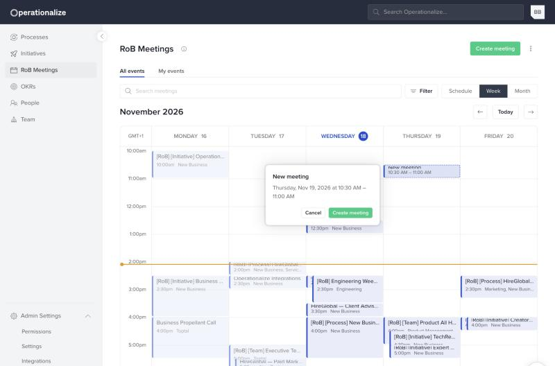
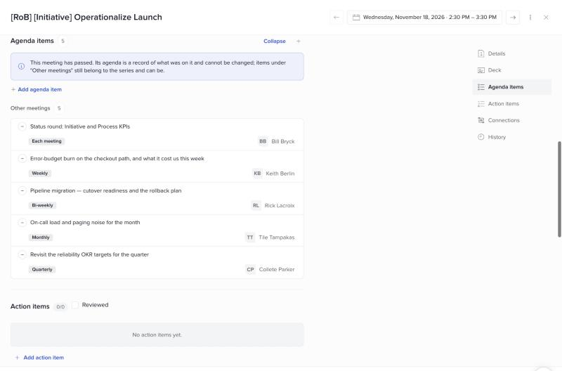
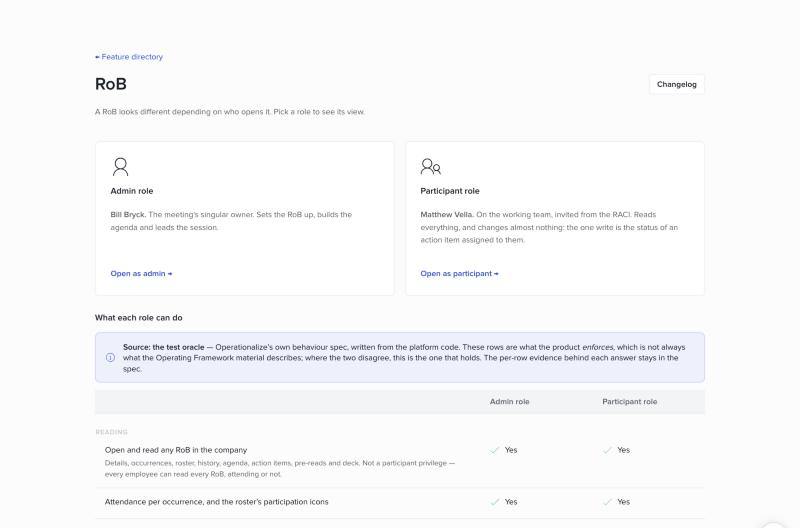
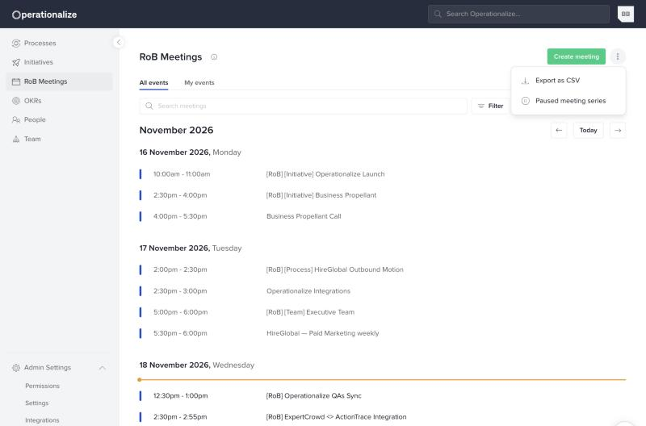
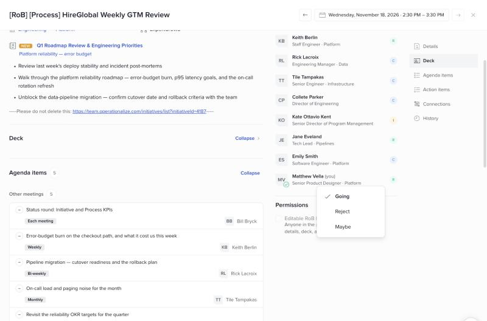
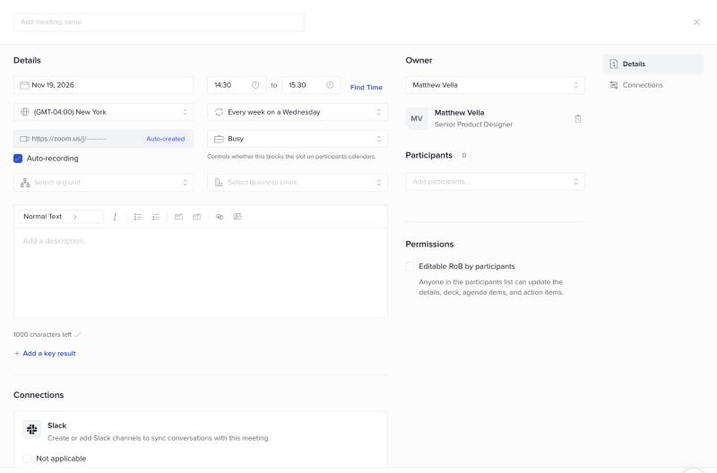

# RoB Meetings — prototype changelog

Where this prototype and the product disagree, and why. That is the section
directly below; the rest of the file is how it got there.

- **[Reach the variants](#reach-the-variants)** — the flows that only exist
  behind a URL. Several good ideas live there and nowhere else.
- **[Open, and worth revisiting](#open-and-worth-revisiting)** — decisions that
  were parked rather than settled, each with the commit that still holds the
  work.
- **[History](#history)** — what was built, in what order.

---

## Where it departs from the product

**The reason this file exists.** A prototype that matched the product in every
respect would need no changelog — you could read the product. These are the
places it does not, each with the rule that says what the product does.

**We propose a change.** Built deliberately against the rule, because we think
the rule is wrong. Each one is a proposal, and needs saying out loud when it
goes to review.

| Here | The product | Rule |
|---|---|---|
| A week-view slot click draws a draft block and asks **Create meeting / Cancel** | opens the Create meeting form straight away | `ROB-VIEW-053` |
| Recurrence offers weekly and bi-weekly, with monthly marked approval-only | defaults to Every weekday, and offers daily, custom and the rest | `ROB-SCHED-002`, `-004` |
| Every filter is single-select | Divisions and Slack channels are multi-select, and the tag reads `Divisions: <names>` | `ROB-VIEW-026`, `-027` |

**We follow the spec where the product does not.** Not proposals: the rule is
already the rule, and the shipped code has an open deviation from it. Built to
the rule, with the deviation's id beside it — so a reviewer who tries this in
the real app and sees something else knows which of the two is the bug.

| Here | The product today | Rule | Deviation |
|---|---|---|---|
| A cancelled occurrence's agenda is read-only, and says why | its agenda items, action items and pre-read links stay editable | `ROB-AGENDA-065` | `B-187` |
| **Mark as discussed** appears only once the occurrence has started | it is offered and accepted on any occurrence, future ones included | `ROB-AGENDA-066` | `B-191` |

A row leaves this section when the product adopts the proposal, overrules it, or
fixes the deviation — not when we stop thinking about it.

---

## Reach the variants

The prototype is one file; a variant is a URL, not a copy. (`rob` is ~1.2 MB and
still moving — a duplicate drifts within days.) The rule was learned the hard
way: this started in Aug 2026 as `action-items`, beside a near-duplicate called
`rob-flow` that every change had to be mirrored into. Both of those early flows
sit in `../archive/`, and the old `/action-items/` URL 404s.

| URL | What it opens |
|---|---|
| `rob/` | the admin owner's view — Bill Bryck, who owns this series *and* holds "Manage all RoB meetings" |
| `rob/roles.html` | the role chooser, this prototype's sign-in screen. Sign out returns here |
| `rob/rights.html` | the oracle rights table — **What each role can do**, from the button beside the chooser's title. This file is rendered on the chooser itself, below the role cards |
| `rob/?role=participant` | the participant's view — Matthew Vella, attending, assignee of one action item |
| `rob/?role=rob-admin` | an admin who does **not** own the series, so the deck rights are absent (`ROB-ACCESS-002`) |
| `rob/?roles=1` | the bottom-left role switcher, for walking all three side by side |
| `rob/#respond=modal` | the original respond flow — the row's icon opens the reject modal directly. `=direct` is a synonym, and `?respond=` works too |
| `rob/#occurrence=YYYY-MM-DD` | deep-links one occurrence of the meeting named in the view |

Default respond flow is the **status menu** (Going / Reject / Maybe), not the
modal. Prefer the hash form: the desktop preview pane drops `?params` on the way
to the page, and a hash survives both it and Vercel.

---

## Open, and worth revisiting

- **Agenda items in the Create form.** Built, wired against `ROB-AGENDA-001…038`,
  then removed: the product has no agenda section at create time, and whether it
  should is the open spike **TOP-7338**. The call was "a shell first, populated
  from the meeting view". If the spike lands the other way, the working version
  is in commit **b14f2c6** — take it from there rather than rebuilding.
- **Eight static `.btn-primary`, one per modal.** The only reason this file still
  carries its `designmd:legacy` marker. The `[two-primary]` rule exempts
  script-built surfaces — one is never on screen beside the page's own CTA — but
  not static hidden overlays. Flattening a modal's confirm to secondary would be
  the wrong fix, so it needs a decision, not a workaround.
- **The rejection tooltip wants a badge.** The reference shows a "Declined" pill
  above the sentence; designmd's tooltip is one plain-text string driven by
  `attr()`, so it cannot carry one. The copy was written to stand without it
  ("declined this meeting"). Switching to a DOM tooltip was left as a later ask.
- **The Slack channel names are invented.** A screenshot of the real app showed
  `-c-proj-…` and `-ba-bau-…` prefixed channels that look nothing like these.
  The fixtures obey `ROB-VIEW-027`; they do not look like the tenant. Paste the
  real list over `SLACK_CHANNELS` when someone has it.
- **Click-to-create asks first.** See [the departures](#where-it-departs-from-the-product).

---

---

## History

### 2026-11-13 — Click to create, on the week view *(7ed5064, local on `rob-filters-and-click-to-create`)*

**Status** · Proposed — it asks before opening the form where the product opens it (`ROB-VIEW-053`), so it is a change to propose, not a screen to copy. The group has not seen it, and RoB is not what the team is working on, so expect it to sit for a few weeks.

An hour in the week grid is now two 30-minute slots, as real elements rather
than arithmetic on a column click — "a past slot shows no pointer"
(`ROB-VIEW-053`) is a per-slot affordance a column cannot carry. Clicking an
empty future slot draws a 30-minute draft in place, the same block and type as a
meeting but dashed while it is only a proposal, and a popover beside it asks:
**Cancel** / **Create meeting**.

**The confirm step is the proposal.** `ROB-VIEW-053` opens the form on the
click. The week is dense, the form is full-screen, and a mis-click is far
cheaper to make than to get out of — so the draft is drawn and the question
asked first. What **Create meeting** finally opens is the same form, pre-filled
the same way the month grid's click-to-create fills it: date, slot start, slot
start + 30.

Escape, a click elsewhere, or **Cancel** clears the draft; clicking a different
slot moves it rather than closing first. Anything that redraws the week — a
filter, a tab, a lifecycle change — clears it too. The popover is fixed-position
on the body, because `.cal-week-body` clips: a panel beside a Friday slot or a
7 pm one would otherwise be cut in half.

The rule's known deviation, **B-136** (the 23:30 slot pre-fills an end before
its start), cannot arise here — the grid stops at 8 pm.

### 2026-11-10 — Divisions and Slack channels start filtering *(ea3d17c, local on `rob-filters-and-click-to-create`)*

**Status** · Delivered — the behaviour follows the rules. The fixture data is invented and does not resemble the tenant's, which is still [open](#open-and-worth-revisiting).

Two of the six filter controls had been built and wired to nothing. They narrow
the calendar now, which meant inventing the data they narrow by — and that is
the part worth recording.

**The oracle holds rules, not data.** There is no seed fixture, tenant record or
instance list anywhere in it: no real division names, no channels, no teams. So
"pull the real ones from topteam" has no answer. What it gives is the rule a
fixture has to obey, and the fixtures here were built to obey it. `ORG-DIV-001`
sets the shape — three categories holding six kinds (Category, Practice,
Service; Vertical, Specialization; Segment) — and fifteen divisions cover all
six. **General** is the one name that is not invented: the built-in segment
every tenant has.

Options carry the division's icon and its kind, sorted by hierarchy level then
name (`ROB-VIEW-026`).

**The ten-channel cap is demonstrated, not just respected.** `ROB-VIEW-027`
offers at most ten channels per search, so the pool is fifteen: five are
reachable only by typing, which is the only way a reader sees that the cap is
there. A leading `#` in the search is ignored, per the same rule. Each entry is
the default channel of a series in `SERIES`, newest first.

**A private channel is marked twice, and the padlock is not in the icon
column.** Put there it sits a whole `--spacing-3` gap further left than the
public rows' `#`, and every private name falls out of line with every public
one. It goes inside the label instead, where the `#` goes — the name's own
prefix — and the `Private` tag goes flush right, which `.dropdown-item-text`
(`flex: 1`) does for free without adding a row's height. The tag is
`.tag.tag-light`; `components.css:43` sanctions an icon inside a tag.

**The kind line is `.field-hint`, which has to replace `.dropdown-item-description`,
not join it** — the description rule is defined later in the stylesheet and wins
if both are applied. That buys the kit's 12px caption (`--type-caption`) in
`--color-text-subtle`, which is pale: roughly 1.8:1 on the menu's white. It
reads, but it is the thing distinguishing one division kind from another.
`.field-label` is the same caption at `--color-text-muted` if that turns out to
be too quiet.

**The trap, again:** `DIV_ICON` holds whole `<svg>` markup rather than a slug.
An icon id assembled at runtime never appears in the file as a literal
`href="#i-…"`, so `inline.py` narrows the sprite without it and the icon bakes
blank. Static-icon count went 72 → 77 when this was fixed.

### 2026-11-10 — Agenda items, and a prototype that stops going stale (b256097, #157)

**Status** · Delivered

**Agenda items belong to the series, not the occurrence.** What a meeting shows
is a filter over that list, so the section renders two groups — "This meeting",
numbered, and "Other meetings", dashed — with the add control between them,
where the product puts it. That shape is what makes the occurrence nav mean
anything: last week's agenda is a frozen, read-only snapshot that still shows an
item since deleted from the series; today's is live; next week's offers
everything except "Mark as discussed".

Remove re-anchors a recurring item to the next occurrence that is not cancelled,
so it leaves this meeting and reappears under "Other meetings"; Remove on a
one-off deletes outright, with no confirmation, because there is nothing to
re-anchor. Delete is offered only on an "Other meetings" row and is the one
agenda action with a dialog. **Nothing raises a success toast** — the refreshed
list is the confirmation.

**The bug worth remembering:** the frozen snapshot was written when a past
agenda was first *read*. Not enough — it has to be written before any item
*changes*, or editing today's meeting silently rewrites one that already
happened. All nine mutating paths freeze first.

**Dates move with the clock.** Nothing is pinned to a calendar date. One module
sets the anchor to the Wednesday of the week the page is opened in, and every
fixture keeps the distance it had from the date it was authored against — one
Wednesday to another is a whole number of weeks, and the series are defined by
weekday, so weekdays never drift. The month grid is *rebuilt* for whatever month
the anchor lands in, not shifted: a month view is month-shaped. That rebuild
exposed bi-weekly series being keyed off the grid's first row — an accident of
which weekday a month starts on — so they now count from the anchor's own row.

Also: the when-pill arrows had never had a handler; the `#occurrence=` deep link
looked for its chip mid-parse and, given four series meet on a Wednesday, opened
the first match rather than the right one.

### 2026-11-09 — The series lifecycle, and the loop it closes (dd1666c, #156)

**Status** · Delivered

One menu in the meeting-view header: Transfer ownership, Pause / Resume series,
Cancel this meeting only / Restore, and Delete meeting series last and red.
Cancel and Delete only on an occurrence that is neither cancelled nor started;
Restore only on a cancelled one. **Titles, body copy, labels and toasts are the
product's own rather than paraphrased** — a destructive confirmation is the one
place a prototype can be wrong and still read as fine.

**The hole this closed:** pausing takes a series off the calendar, and Resume
lives only in the meeting view — so a paused series was stranded on a read-only
list. Those rows are buttons now, carrying the calendar chips' own
`data-modal-open` and `data-occurrence`, so existing handlers do the work.

Transfer ownership excludes any row whose second line is an e-mail rather than a
job title — a bot or unmapped guest can sit on an invite and cannot hold a
series. Keyed on that marker, not on the name, because the next bot will be
called something else.

### 2026-11-09 — Viewer roles, a create shell, three display fixes (01731dd, #154)

**Status** · Delivered

**Rights are not one ladder**, which is why the table is written out rather than
modelled as a scale: an owner is not an admin ("Manage all RoB meetings" is
global), and an admin is not an owner (deck rights stayed with the owner when
everything else was handed to admins). A single owner-to-participant scale gets
both backwards.

**Hidden, not disabled** — `ROB-EDIT-001` says participants "do not see them",
and a disabled control promises a right that does not exist. Disabled is kept
for a right the viewer *has* that the integration is blocking. Reading is never
gated: every employee reads every RoB.

Also in this pass: the chooser's cards renamed to Admin role / Participant role;
a new meeting owned by whoever creates it, read off the topbar account menu so
the two cannot disagree; the owner, timezone, recurrence, availability, org unit
and participants fields became real `.input-select`s instead of readonly inputs
with a chevron glued beside them. And the **migration off the `--ic-*`
vocabulary** — 764 references across 41 tokens — which is what let the kit reach
this file again, and immediately surfaced four faults the frozen build had been
hiding, the off-canvas sidenav among them.

### 2026-11-05 — Role chooser, calendar views, filters, More menu (4d02f3a, #152)

**Status** · Delivered

**Three calendar views from one dataset.** Nineteen series with a weekday and a
weekly or bi-weekly cadence generate the month (72 occurrences), the week and
the schedule, so they cannot disagree. Month caps a day at three and offers the
rest; week places blocks by start time and sizes them by duration, stepping
overlaps sideways; schedule lists the week and stops at the end of it.

**Four event states, not nineteen colours.** Colour had been a per-series
category. It is a per-occurrence *state* — blue, yellow for a warning, red for
an error, gray once cancelled — so they are semantic tokens now, and the reason
travels with the colour in the tooltip, since a yellow rule on its own does not
say what is wrong.

The role chooser arrives: a RoB reads differently for the Accountable Owner who
runs it and the Participants invited to it. Filters that genuinely narrow all
three views are live; the ones with no data behind them are built but inert.

### 2026-09-29 → 2026-09-30 — The key metric flow (#45–#49)

**Status** · Delivered

A fixed, hard-coded key result became a full lifecycle: a ghost "+ Add key
metric" when there is none, a select that searches the OKR catalogue or opens a
custom-metric modal, then the row itself. The list carries 20 OKRs but offers
four up front — what fits the menu without scrolling — and searching reaches the
rest. A hand-set metric is tagged with the custom OKR glyph so it is
distinguishable from a real Key Result at a glance. Delete names the metric,
since there is no undo.

Run in the Create modal too (`3206282`), as a **factory** over
`[data-md-kr-flow]` rather than a duplicated IIFE, so two instances cannot
cross-wire. The shared Set up KPI and delete-confirm dialogs each record which
flow opened them.

**Drawn-but-unbuilt controls say so** (`396b432`). Fifteen inert controls now
carry `data-rob-todo` and one delegated handler raises "… is not built in this
prototype yet." Search fields say it once, on the first keystroke. RoB Meetings
and All events stay plain no-ops — they are the current page and view, so "not
built" would be wrong.

Also: past occurrences faded with **colour**, not opacity, which would have
dimmed the tooltip too; the attendance marker moved onto an unclipped wrapper,
because `overflow` is powerless against the avatar's `clip-path` chamfer.

### 2026-09-23 — Answering an invite (#36, #37)

**Status** · Delivered

**Declining and going tentative are one decision with two answers**, so the
modal asks for the answer first and the rest follows: the CTA reads Reject
meeting or Mark as tentative, the reason prompt changes, and the two options
that belong only to a rejection — asking to be dropped from the series,
proposing another time — are hidden or cleared on a maybe. Those two also rule
each other out, and the blocked control keeps its click and explains itself in
the snackbar rather than going dead (`aria-disabled`, not `disabled`).

The row's icon carries state, not just a verb: the plain person glyph while
attending, the removed-user glyph once answered — red for declined, amber for
tentative. In the menu variant a maybe keeps the plain person in amber, because
tentative is not a removal; the row is still expected.

**The menu variant was introduced here, as one file rather than a copy** — the
reasoning that still governs variants in this prototype.

### 2026-09-16 — The meeting view, inline edit, reject flow (#5b220be → 6ef66d4)

**Status** · Delivered

Edit stopped opening a separate modal: `#meeting-detail.is-editing` swaps the
read-only icon-row grid for the same input grid the create modal uses, and the
title becomes contenteditable. Cancel snapshots and restores every
contenteditable node.

The reject flow landed, then was refined twice in the same week — worth reading
as a sequence, because the second pass reverses part of the first. Rejecting all
events and asking the organizer to drop you from the series are one intent and a
stronger version of it, so the checkbox was **nested under the "All events"
radio** rather than standing alone further down. A checkbox, not a switch: a
switch implied a separate mode. And the rejection detail became a hover tooltip
on the person row, composed from the form.

### 2026-09-10 — Full-screen create and view modals (e7f2f26)

**Status** · Delivered

`.modal-full` arrives, the Details section is rebuilt from Figma `31083:50091`,
and **field labels leave Details entirely** — every input carries a leading
semantic icon instead, with the caret still on the right. The right-rail TOC
highlights the section whose top crosses ~40% of the viewport, chosen so the
last, short section still becomes active at maximum scroll.

---

## Keeping this honest

- An entry records the **reason**, not the diff — `git log --follow -- rob/index.html`
  has the diff, and these entries are distilled from its messages.
- **History is about the product, not about this repo.** An entry earns its
  place by changing what a RoB looks like or how it behaves. A rename, a lint
  pass, a dead-class sweep, a change to this page's own plumbing — those are
  real work and they are in `git log`, which is where someone goes looking for
  them. Here they pad the one thing the file is for: what we decided about the
  product, and why. If an entry has nothing to screenshot, ask whether it has
  anything to say.
- **A history entry that creates a departure adds the row.** The entry says why
  we did it once; [Where it departs from the product](#where-it-departs-from-the-product)
  is where someone finds it without reading the history. An entry that builds a
  rule the shipped product gets wrong belongs in the second table, with the
  deviation id — not the first, because following a rule is not a proposal.
- **Correcting the prototype against the spec is operational, not a decision.**
  Finding that a control was enabled for the wrong role, or that a right
  follows attendance rather than ownership, changes the prototype but decides
  nothing: the rule was always the rule. What that work produces belongs in
  [What each role can do](rights.html), which states
  the rules as they stand — an entry would only add that we were once wrong
  about them.
- When a parked idea is picked up or finally rejected, move it out of
  **Open, and worth revisiting** and say which it was.
- When a proposal here is adopted by the product, or overruled by it, move the
  row out of **Where it departs from the product**.
- **Every entry carries exactly one status.** A `**Status**` line under the
  heading says which: **Proposed** (built here, and a change to the product
  rather than a description of it), **In review** (built and waiting on the
  group), **Delivered** (built, settled, and in the prototype as it stands),
  **Cancelled** (decided against; the entry stays, because why it was dropped
  is the useful part). Delivered is about the design, not about git — whether
  the commit has reached `main` is in the heading, with the branch. Then an em dash and one sentence, where there is
  anything to add. The page renders the first word as a tag and ignores any
  others, so two states is not a thing you can express — pick the one that is
  true today and change it when it changes.
  **Delivered never means the product shipped it.** It means we finished
  designing it. What the product does comes from the oracle; where we propose changing
  it is [Where it departs from the product](#where-it-departs-from-the-product).
- **Every entry carries a shot** — one screenshot, written as a plain image on
  its own line and kept in `_shots/`, named for the entry's date. An entry with
  nothing to show is an entry about the repo, and belongs in `git log` instead.
  The alt text is the caption on the page and the only description on GitHub,
  so write it as a sentence about what the screen is doing, not "screenshot".
  Shoot it from the running prototype, not from a design file — the point is
  what was built.
- A hash on an unmerged branch is not the hash it will have on `main` — the
  squash rewrites it. An entry cites the branch until it merges, then the
  commit and its PR number, like every entry below 2026-11-10.
- Cite rule ids; never paste the oracle's prose into this repo.
